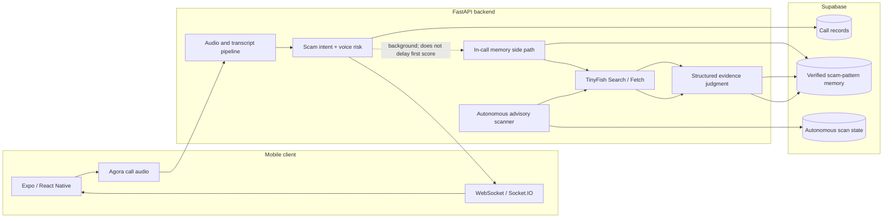
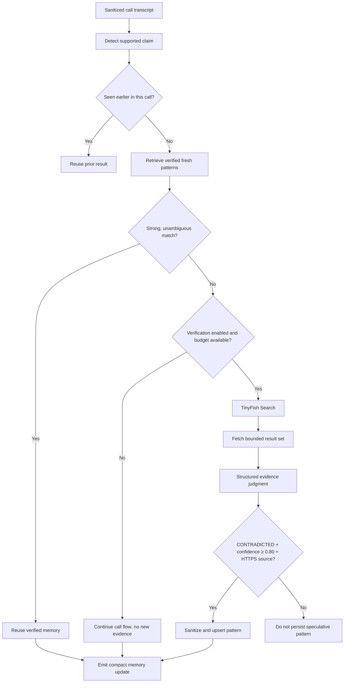
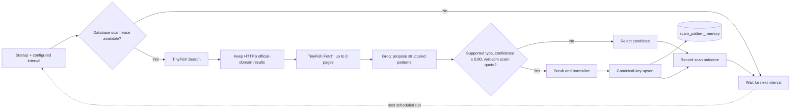

# TruVoice

[](https://www.python.org/)
[](https://fastapi.tiangolo.com/)
[](https://docs.expo.dev/versions/v54.0.0/)
[](https://reactnative.dev/)
[](https://supabase.com/)
[](https://tinyfish.ai/)

TruVoice is a real-time voice-call safety application. It combines local audio
analysis, speech transcription, scam-intent signals, live risk updates, and
evidence-based web verification. A backend-only scam-memory system supports
both on-call verification and scheduled ingestion of public scam advisories.

## Contents

- [Product capabilities](#product-capabilities)
- [System architecture](#system-architecture)
- [Scam memory and TinyFish](#scam-memory-and-tinyfish)
- [Technology stack](#technology-stack)
- [Requirements](#requirements)
- [Setup](#setup)
- [Database setup](#database-setup)
- [Configuration](#configuration)
- [Run the application](#run-the-application)
- [Tests](#tests)
- [Operational notes and limitations](#operational-notes-and-limitations)
- [Repository layout](#repository-layout)

## Product capabilities

- Live audio-call analysis with chunked audio processing and partial/final
  transcript updates.
- Speech-to-text using the configured local faster-whisper model.
- Voice authenticity and scam-intent scoring combined into a unified risk
  signal.
- Live call status and risk delivery over the existing WebSocket and Socket.IO
  integrations.
- Call history, call details, caller/contact flows, and Agora-backed calling.
- Guardian settings and email contacts, with severe alerts gated on consecutive
  severe analysis windows.
- Elderly mode with larger call-screen presentation and spoken severe-risk
  warnings.
- TinyFish-assisted web search and source fetching for uncertain scam claims.
- Verified scam-pattern memory with semantic retrieval when a local embedding
  model is configured, plus lexical fallback.
- A scheduled autonomous memory scanner that searches for new public advisories
  without running on the live call-scoring path.

## System architecture



The live score is emitted before the in-call memory side path starts. The
autonomous scanner is scheduled separately from audio analysis.

## Scam memory and TinyFish

Two bounded ingestion paths feed the same canonical
`scam_pattern_memory` table:

### In-call verification



The current detector supports a bounded set of claims: OTP and credential
requests, remote-access apps, suspicious fees, bank impersonation, and
digital-arrest/legal threats. Weak, stale, conflicting, or absent matches may
be verified, subject to the configured per-call limit and minimum interval.

### Autonomous public-advisory ingestion

The `autonomous` branch adds a scheduled scanner. Each pass is bounded to a few
public-safety queries and at most three official pages:



The scanner is a bounded advisory ingester, not a general-purpose agent. It
does not crawl arbitrary websites, invent seed records, or watch the entire web.
It requires a continuously running backend process; suspended serverless
deployments need an external scheduler.

### Storage, retrieval, and privacy

| Stored | Not stored |
| --- | --- |
| Sanitized canonical patterns, tactics, and risk indicators | Raw audio or call transcripts |
| Verification status, confidence, occurrence and freshness metadata | OTPs, phone/account numbers, or national IDs |
| Compact HTTPS source references and domains | Fetched page contents or URL query strings/fragments |
| Optional local embedding vector | External embedding API data |

Canonical keys deduplicate patterns; repeat observations refresh occurrence
metadata. Retrieval filters for verified, active, fresh patterns. A local
384-dimensional model enables pgvector semantic retrieval, with lexical
fallback; without that model, lexical retrieval can still be used. Memory can
raise risk but never lowers it.

**TinyFish APIs**

| API | Request |
| --- | --- |
| Search | `GET https://api.search.tinyfish.ai?query=...` |
| Fetch | `POST https://api.fetch.tinyfish.ai` with URLs and `format: "markdown"` |

Both use the backend `TINYFISH_API_KEY`. In-call verification also respects
`TINYFISH_ENABLED`, `CLAIM_MAX_PER_CALL`, `CLAIM_MIN_GAP_S`, and
`WEB_EVIDENCE_TIMEOUT_S`.

For autonomous scanner configuration and SQL checks, see
[`Backend/AUTONOMOUS_MEMORY.md`](./Backend/AUTONOMOUS_MEMORY.md).

## Technology stack

| Area | Technology |
| --- | --- |
| Mobile application | React Native, Expo SDK 54, JavaScript |
| Navigation and state | React Navigation, Zustand |
| Voice calling | Agora React Native SDK |
| API | FastAPI, Uvicorn, Pydantic |
| Realtime | WebSocket, Socket.IO |
| Database | Supabase PostgreSQL |
| Vector retrieval | pgvector; optional local Transformers embeddings |
| Audio and speech | Local voice model, faster-whisper, librosa |
| Web evidence | TinyFish Search and Fetch |
| Structured evidence judgment | Groq |

## Requirements

- Python 3.12 is the recommended backend runtime.
- Node.js and npm compatible with the installed Expo SDK 54 dependencies.
- A Supabase project and backend service-role key.
- TinyFish API key for live web verification and autonomous scans.
- Groq API key for structured evidence judgment and autonomous extraction.
- Agora project credentials for real Agora calling.
- The configured voice-model checkpoint and sufficient resources for local
  audio inference.
- The spaCy English model `en_core_web_sm` for the memory privacy scrubber.
- Optional: a local Transformers model that returns 384-dimensional
  embeddings for semantic memory retrieval.

## Setup

### Backend

From the repository root, create and activate a virtual environment:

```powershell
cd Backend
py -3.12 -m venv .venv
.\.venv\Scripts\Activate.ps1
python -m pip install --upgrade pip
pip install -r requirements.txt
python -m spacy download en_core_web_sm
```

Copy `Backend/.env.example` to `Backend/.env` and configure the required values
described in [Configuration](#configuration). Keep the service-role key and
provider credentials out of source control.

### Frontend

```powershell
cd Frontend\TruVoice
npm install
```

Copy `Frontend/TruVoice/.env.example` to `Frontend/TruVoice/.env.local` and
set the API/WebSocket URLs and Expo Agora app ID. Because the app uses native
Agora modules, use a compatible development build rather than assuming Expo Go
supports every calling feature.

## Database setup

Run the migrations against the Supabase project configured in the backend,
in this order:

1. `Backend/migrations/001_scam_pattern_memory.sql` — canonical memory table,
   vector/lexical indexes, search functions, and service-role access.
2. `Backend/migrations/002_monotonic_call_risk.sql` — atomic monotonic risk
   persistence for memory-driven risk updates.
3. `Backend/migrations/003_autonomous_memory_scan.sql` — autonomous scan lease
   and latest-run status/statistics.

Creating these tables and functions does not itself populate scam memory. Rows
are added only after an ingestion path finds evidence that passes validation.
Use these queries to inspect the latest scanner run and stored patterns:

```sql
select last_started_at, last_finished_at, last_status,
       last_queries_completed, last_pages_fetched, last_candidates_found,
       last_candidates_rejected, last_patterns_stored, last_error, next_scan_at
from public.autonomous_memory_scan_state
where id = 1;

select scam_type, verification_status, active, confidence,
       occurrence_count, source_domains, embedding_model, created_at
from public.scam_pattern_memory
order by created_at desc
limit 25;
```

## Configuration

The backend loads `Backend/.env`; the mobile app loads
`Frontend/TruVoice/.env.local`. They are separate environments.

| Variable | Purpose |
| --- | --- |
| `SUPABASE_URL` | Supabase project URL |
| `SUPABASE_KEY` | Backend service-role key; never expose it to the app |
| `SECRET_KEY` | Backend JWT signing secret |
| `GROQ_API_KEY` | Structured web-evidence judgment and autonomous extraction |
| `TINYFISH_API_KEY` | TinyFish Search and Fetch authentication |
| `TINYFISH_ENABLED` | Enables or disables TinyFish verification |
| `OFFICIAL_DOMAINS` | Comma-separated source host allowlist |
| `MEMORY_EMBEDDING_MODEL_PATH` | Optional local 384-dimensional embedding model |
| `AUTONOMOUS_MEMORY_ENABLED` | Enables the scheduled advisory scanner |
| `AUTONOMOUS_MEMORY_INTERVAL_SECONDS` | Scan interval; default is `21600` seconds |
| `AUTONOMOUS_MEMORY_TIMEOUT_S` | Structured extraction timeout |
| `CLAIM_MAX_PER_CALL` | Maximum in-call checks per call |
| `CLAIM_MIN_GAP_S` | Minimum spacing between in-call checks |
| `WEB_EVIDENCE_TIMEOUT_S` | TinyFish Search/Fetch timeout |
| `AGORA_APP_ID`, `AGORA_APP_CERTIFICATE` | Backend Agora token configuration |
| `EXPO_PUBLIC_API_URL` | Backend HTTP base URL for the app |
| `EXPO_PUBLIC_WS_URL` | Backend WebSocket base URL for the app |
| `EXPO_PUBLIC_AGORA_APP_ID` | Agora app ID used by the app |

See [Backend/.env.example](./Backend/.env.example) and
[Frontend/TruVoice/.env.example](./Frontend/TruVoice/.env.example) for the full
configuration templates.

## Run the application

Start the backend from `Backend`:

```powershell
.\.venv\Scripts\Activate.ps1
uvicorn app.main:sio_app --host 0.0.0.0 --port 8000 --reload
```

The API root is `http://localhost:8000/`; interactive API documentation is
available at `http://localhost:8000/docs`.

Start the Expo development server from `Frontend/TruVoice`:

```powershell
npm start
```

Use the relevant Expo development build for Android or iOS when testing Agora
calling. On a physical device, configure the backend URLs to an address
reachable from that device rather than `localhost`.

## Tests

Run frontend tests:

```powershell
cd Frontend\TruVoice
npm test
```

Run backend tests from `Backend`:

```powershell
.\.venv\Scripts\Activate.ps1
python -m unittest discover -s tests -p "test_*.py" -v
```

Focused in-call memory checks:

```powershell
python -m unittest discover -s tests -p "test_scam_memory.py" -v
python -m unittest discover -s tests -p "test_memory_routing_workflow.py" -v
```

Autonomous scanner tests:

```powershell
python -m unittest discover -s tests -p "test_autonomous_memory_scanner.py" -v
```

## Operational notes and limitations

- The autonomous scanner requires a long-running FastAPI process. The project
  also includes a Mangum handler; serverless deployments should use an external
  scheduler rather than relying on a lifespan task.
- A scan can finish successfully with zero patterns stored. Search results may
  have no allowlisted pages, pages may contain no supported scam categories, or
  candidates may fail quote/confidence checks.
- The system does not guarantee that the first scheduled scan will populate
  memory; check `autonomous_memory_scan_state.last_error` and backend logs.
- Semantic retrieval requires a local model with exactly 384 output
  dimensions. No model is downloaded automatically.
- Scam claim detection and memory category mapping are bounded by the
  categories implemented in the backend.
- Memory-storage privacy constraints do not change any separate,
  pre-existing call-history storage behavior.
- Live TinyFish, Supabase, Agora, and model performance depend on valid
  credentials, deployed migrations, network access, and local hardware.

## Repository layout

```text
Backend/
  app/
    routers/          FastAPI routes for analysis, calls, auth, and guardians
    services/         Audio, web verification, and scam-memory services
  migrations/         Supabase SQL migrations
  tests/              Backend unit and integration tests
Frontend/TruVoice/
  src/                Screens, hooks, state, and services
  tests/              Frontend Node.js tests
```